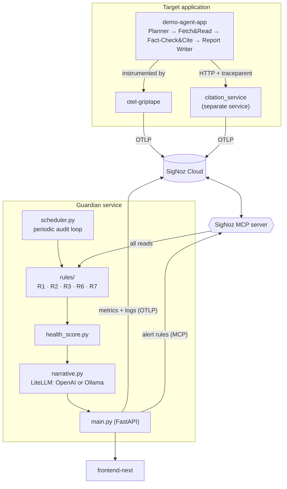

# Telemetry Health Guardian

**An auditor for observability data itself.** Most tools watch what an AI
agent *does*. Guardian checks whether the *telemetry describing the agent*
can be trusted — and points at the instrumentation that broke it.

Broken telemetry rarely fails loudly. A span loses its parent, a token
count goes missing, a tool result is silently cut off before it reaches the
model — and dashboards keep looking fine. Guardian queries
[SigNoz](https://signoz.io) through the **SigNoz MCP server**, runs five
detection rules over the stored spans, scores each service 0–100, explains
the findings in plain language with span-ID citations, and writes the
results back into SigNoz as metrics, logs, and alerts.

---

## Contents

- [Components](#components)
- [Architecture](#architecture)
- [The rules](#the-rules)
- [Health score](#health-score)
- [Chaos injection](#chaos-injection)
- [Setup](#setup)
- [Reproducing an audit](#reproducing-an-audit)
- [API reference](#api-reference)
- [Repository layout](#repository-layout)
- [Known limitations](#known-limitations)

---

## Components

| Component | What it is |
|---|---|
| [`otel-griptape/`](otel-griptape/README.md) | OpenTelemetry auto-instrumentation for the [Griptape](https://github.com/griptape-ai/griptape) agent framework, which has no maintained OTel package. Emits GenAI semantic-convention spans, propagates context across threads, and forwards W3C `traceparent` on outbound HTTP. Installs standalone and works with any OTel backend. |
| [`demo-agent-app/`](demo-agent-app/README.md) | The workload under audit: a four-stage document research pipeline (**Planner → Fetch & Read → Fact-Check & Cite → Report Writer**), plus a separate `citation_service` and a seeded fault injector (`chaos.py`). |
| [`guardian/`](guardian/README.md) | The auditor: a FastAPI service that runs the rule engine on a schedule, computes health scores, generates LLM narratives, answers questions via chat, and writes results back to SigNoz. |
| `frontend-next/` | Next.js dashboard: per-service health, findings, rule trends, chat, and a panel for triggering demo/chaos runs. |

The demo pipeline was chosen because its natural failure modes map onto the
rules. The clearest example: a 35-page PDF where only part of the text ever
reaches the model's context window, producing a confident, wrong answer
with no error anywhere — exactly what R6 exists to catch.

---

## Architecture



**Data flow**

1. The demo app and `citation_service` emit spans; `otel-griptape` shapes
   them to the GenAI semantic conventions.
2. SigNoz Cloud ingests them over OTLP.
3. Guardian reads spans **only through the SigNoz MCP server** — never a
   direct SigNoz API call.
4. The rule engine produces findings → a health score → an LLM narrative
   that cites span IDs.
5. Guardian writes back to SigNoz:
   - **Metrics and logs** via direct OTLP. The MCP server cannot write raw
     telemetry; its writable resources are dashboards, alerts, notification
     channels, and saved views.
   - **Alert rules and notification channel** via MCP
     (`signoz_create_alert`, `signoz_create_notification_channel`).

Metrics emitted: `telemetry.health_score`, `telemetry.missing_field_rate_pct`,
`telemetry.cardinality_risk_score`, `telemetry.orphaned_span_rate_pct`,
`telemetry.truncation_rate_pct`, `telemetry.cross_service_break_rate_pct`.

---

## The rules

Every rule module in `guardian/rules/` has the same shape:

- **`evaluate(...)`** — pure detection logic over plain Python data. Fully
  unit-tested with no network or SigNoz needed.
- **`fetch_*(...)` / `run(...)`** — a thin adapter that pulls the data via
  MCP tools (mostly `signoz_execute_builder_query` with explicit
  `selectFields`, because the convenience search tools omit custom
  attributes from their rows).

Each result reports its **denominator** (e.g. `total_gen_ai_spans`), so
"found nothing to check" is always distinguishable from "checked and
healthy".

### R1 — Missing GenAI attributes

**Catches:** LLM-call spans missing the fields needed to understand cost and
behavior.

**Scope:** spans where `gen_ai.operation.name == "chat"`. Tool-call spans
are excluded because they carry `gen_ai.tool.name` instead, by design.

**A span is non-conformant if either:**
- it lacks any of `gen_ai.system`, `gen_ai.request.model`,
  `gen_ai.usage.input_tokens`, `gen_ai.usage.output_tokens`,
  `gen_ai.response.finish_reasons`; or
- its name isn't exactly `"{operation} {model}"`, e.g. `chat gpt-4.1-nano`.

**Output:** `score = conformant / total`. Missing-field and naming findings
are reported as separate kinds. The attribute names are imported from
`otel_griptape.semconv`, so the emitter and the checker can't drift apart.

### R2 — Cardinality risk

**Catches:** raw content (documents, prompts) leaking into indexed span
attributes, which bloats storage and query cost.

**An attribute key is flagged only when both hold:**
- `distinct_values / total_spans > 0.8`, **and**
- average value length > 200 bytes.

Requiring both avoids false positives on short, naturally unique fields.
Keys containing `trace_id` / `span_id` and SigNoz-reserved keys are
excluded.

**Output:** `cardinality_risk_score = 100 × flagged_keys / evaluated_keys`.

### R3 — Orphaned spans within a service

**Catches:** context lost across async or threaded work, so spans hang off
a parent that doesn't exist.

**Detection:** a span whose `parent_span_id` is **set but doesn't resolve**
to any span in the same trace. Each candidate is cross-checked with
`signoz_search_traces` so a parent that merely falls outside the query
window isn't counted.

**Output:** `orphaned_span_rate_pct = 100 × orphaned / spans_with_a_parent`.
Root spans are excluded from the denominator.

### R6 — Silent truncation

**Catches:** a payload that was only partly delivered to the model.

**Detection:** on spans carrying `payload.raw_bytes` and
`payload.captured_bytes` (set by `otel-griptape`), flag when

```
captured_bytes < raw_bytes × 0.95
```

The 5% slack is fixed. A second check looks for
`gen_ai.response.finish_reasons == "length"` in the same trace, so that
"the input was truncated" and "the model hit its output limit" are reported
as **distinct finding kinds** (`tool_payload_truncated` vs
`model_output_truncated`).

**Output:** `truncation_rate_pct = 100 × truncated / payload_spans`.

### R7 — Cross-service trace breaks

**Catches:** a service-to-service call where the `traceparent` header was
lost, so one request silently becomes two unrelated traces.

**Detection:**
1. List services via `signoz_list_services`.
2. Find outbound call spans in service A that target service B (via
   `peer.service` / `http.url`).
3. Look for spans in B within **2 seconds** of each call.
4. If a span in B is a direct child of the call (same `trace_id`,
   `parent_span_id` = the call's span ID), propagation worked. If instead
   a new **root** span with a different `trace_id` appeared, that's a
   broken handoff.
5. Each span in B is matched to at most one call. The claim checks run
   concurrently inside one trace, so without this a sibling call's healthy
   continuation could mask a broken call next to it.
6. A call with no attributable B span in the window is left unevaluated
   rather than flagged, so slow or failed calls aren't false positives.

R7 is always reported separately from R3: R3 is a break *inside* one
service's trace tree; R7 is a break *between* services.

**Output:** `cross_service_break_rate_pct = 100 × broken / handoffs`.

---

## Health score

Computed per service in `guardian/health_score.py`:

```
health_score = 100
  − missing_field_rate_pct       × 0.30   # R1  ((1 − R1 score) × 100)
  − cardinality_risk_score       × 0.25   # R2
  − orphaned_span_rate_pct       × 0.20   # R3
  − truncation_rate_pct          × 0.20   # R6
  − cross_service_break_rate_pct × 0.05   # R7
```

The final score is clamped to `[0, 100]`; the per-rule terms are returned
unclamped for debugging.

**Alerts** (created at startup only when `GUARDIAN_ALERT_WEBHOOK_URL` is
set):
- health score < 70 for any service
- anomalous spike in cardinality risk
- truncation rate > 5%
- cross-service break rate > 0%

---

## Chaos injection

`demo-agent-app/chaos.py` injects one real fault per rule. Nothing fires
unless `CHAOS_MODE=1`. Each trigger has its own rate (0–1), and
`CHAOS_SEED` makes a run reproducible.

| Rule | Env var | Default | Injected fault |
|---|---|---|---|
| R1 | `CHAOS_R1_RATE` | 0.3 | Drops `gen_ai.usage.input_tokens` or `output_tokens` from a chat span |
| R2 | `CHAOS_R2_RATE` | 1.0 | Writes the full extracted PDF text into the `document.raw_extracted_text` attribute (~26 KB) |
| R3 | `CHAOS_R3_RATE` | 0.3 | Gives a parallel claim-check span a fabricated parent span ID |
| R6 | `CHAOS_R6_RATE` | 1.0 | Routes a claim-check through a local Ollama model with a small context window (`CHAOS_R6_NUM_CTX`, default 2048) |
| R7 | `CHAOS_R7_RATE` | 0.5 | Calls `citation_service` without a `traceparent` header |

**How R6 is real, not simulated:** the R6 path (`ollama_r6.py`) calls
Ollama's `/api/chat` directly with the full document. Ollama silently drops
whatever doesn't fit in `num_ctx`. The span records the full payload as
`raw_bytes` and derives `captured_bytes` from Ollama's reported
`prompt_eval_count` (≈ 4 characters per token). `fetch_and_read.py` itself
never truncates. Ollama calls are serialized, since a local model handles
one at a time anyway, so they don't queue past
`OLLAMA_R6_TIMEOUT_SECONDS`. A call that still fails is marked as an error
span and records no payload sizes, so it never counts as an untruncated
delivery.

---

## Setup

**Requirements:** Python 3.12, Node.js 20.9+, a SigNoz Cloud workspace, an
OpenAI API key (or Ollama for the Guardian's LLM), and
[Ollama](https://ollama.com) with `llama3.2` for the R6 chaos path.

```bash
python -m venv venv && source venv/bin/activate

pip install -r requirements.txt
pip install -e otel-griptape
pip install -e "guardian[test]"
pip install -r demo-agent-app/requirements.txt

(cd frontend-next && npm install)

cp env.example .env
```

### Configure `.env`

| Variable | Purpose |
|---|---|
| `SIGNOZ_INSTANCE_URL` | Your workspace, e.g. `https://<name>.us2.signoz.cloud` |
| `SIGNOZ_MCP_URL` | Hosted MCP endpoint, e.g. `https://mcp.us2.signoz.cloud/mcp` |
| `SIGNOZ_API_KEY` | SigNoz API key, used for MCP |
| `OTEL_EXPORTER_OTLP_ENDPOINT` | e.g. `https://ingest.us2.signoz.cloud:443` |
| `OTEL_EXPORTER_OTLP_HEADERS` | `signoz-ingestion-key=<key>` — the **ingestion key**, which is different from the API key |
| `LLM_PROVIDER` | `openai` or `ollama` |
| `OPENAI_API_KEY`, `OPENAI_MODEL` | For the OpenAI path |
| `OLLAMA_BASE_URL`, `OLLAMA_MODEL` | For the Ollama path and R6 |
| `AUDIT_SERVICES` | Services to audit, e.g. `demo-agent-app` |
| `AUDIT_WINDOW` | Time window per audit, e.g. `15m`, `1h` |
| `AUDIT_INTERVAL_MINUTES` | Scheduler interval |
| `CITATION_SERVICE_URL` | Must match the port `citation_service` runs on (default `http://localhost:8100`) |
| `GUARDIAN_ALERT_WEBHOOK_URL` | Optional; enables alert provisioning |
| `CORS_ALLOW_ORIGINS` | Browser origins allowed to call Guardian and the demo API (default `http://localhost:3000,http://127.0.0.1:3000`) |
| `DEMO_AGENT_RUN_TIMEOUT_SECONDS` | Max duration of one demo-API pipeline run (default `600`) |
| `OLLAMA_R6_TIMEOUT_SECONDS` | Timeout for each R6 Ollama call (default `60`) |

The frontend reads `NEXT_PUBLIC_GUARDIAN_API_URL` (default
`http://localhost:8000`) and `NEXT_PUBLIC_DEMO_AGENT_API_URL` (default
`http://localhost:8001`).

### Verify connectivity

```bash
python verify_mcp_connection.py
```

It should list the `signoz_*` MCP tools and end with `PASS`. A `404` from
SigNoz usually means the workspace URL is wrong or no longer exists. A
`401` on span export means the ingestion key is wrong.

---

## Reproducing an audit

### 1. One-time preparation

```bash
python demo-agent-app/fixtures/generate_fixture_pdf.py   # 35-page PDF used by R2/R6
python guardian/scripts/provision_dashboards.py          # optional: SigNoz dashboard (--dry-run to preview)

ollama serve            # if not already running
ollama pull llama3.2
```

### 2. Start the services (one terminal each)

```bash
# citation service, R7's target
cd demo-agent-app && uvicorn citation_service:app --port 8100

# demo agent API, used by the frontend
cd demo-agent-app && uvicorn api:app --port 8001

# Guardian
uvicorn guardian.main:app --port 8000

# dashboard (optional)
cd frontend-next && npm run dev       # http://localhost:3000
```

### 3. Generate traces

```bash
cd demo-agent-app

# healthy baseline
python app.py \
  --question "What does the Kestrel Basin report say about sea level rise and drought?" \
  --pdf fixtures/long_climate_report.pdf

# chaos run: forcing R7 to 1.0 guarantees every rule fires in one run
CHAOS_MODE=1 CHAOS_SEED=7 CHAOS_R7_RATE=1.0 python app.py \
  --question "What does the Kestrel Basin report say about sea level rise and drought?" \
  --pdf fixtures/long_climate_report.pdf
```

Wait about 20 seconds for SigNoz to ingest the spans.

### 4. Run the audit

```bash
curl -s -X POST localhost:8000/audit/run -H 'content-type: application/json' -d '{}'
```

Example from a single chaos run with default rates, audited over a
10-minute window:

| Rule | Result |
|---|---|
| R1 | 1 of 8 chat spans non-conformant (an injected missing token count) |
| R2 | `document.raw_extracted_text` flagged — 100% distinct, 26,737 bytes |
| R3 | 2 of 39 parented spans orphaned |
| R6 | 6 of 7 payload spans truncated — 26,737 bytes sent, about 4,100 reached `llama3.2` |
| R7 | 1 of 6 citation calls broken — matching the one dropped `traceparent` |

Health score: **76.8 / 100**, with a narrative citing each span ID.
Exact numbers vary per run, since the chaos rolls are random unless
`CHAOS_SEED` is set.

### 5. Ask about it

```bash
curl -s -X POST localhost:8000/chat -H 'content-type: application/json' \
  -d '{"service":"demo-agent-app","question":"Why is the health score below 70 and what should I fix first?"}'
```

### 6. Run the tests

```bash
pytest guardian/tests
(cd otel-griptape && pytest)
```

The `experiments/test_stage3.py` … `test_stage8.py` scripts are the live,
end-to-end verification drivers used during development;
`test_stage8.py` covers R1–R7 against a running Guardian.

---

## API reference

**Guardian** (`:8000`)

| Method | Path | Description |
|---|---|---|
| `GET` | `/health` | Liveness |
| `POST` | `/audit/run` | Run an audit now (same code path as the scheduler) |
| `GET` | `/audit/report/{service}` | Latest cached report; 404 until the first audit completes |
| `POST` | `/chat` | `{"service", "question"}` → answer grounded in the cached report |
| `POST` | `/webhooks/alerts` | Receives SigNoz alert webhooks |
| `GET` | `/alerts`, `/alerts/stream` | Recent alerts, and a server-sent event stream |

**Demo agent** (`:8001`): `POST /run`, `POST /run/upload`, `GET /ollama/models`
**Citation service** (`:8100`): `GET /health`, `POST /verify_citation`

---

## Repository layout

```
telemetry-health-guardian/
├── otel-griptape/              # instrumentation library
│   └── otel_griptape/
│       ├── instrumentor.py         # wraps prompt-driver, tool, and structure runs
│       ├── semconv.py              # gen_ai.* attribute names (shared with R1)
│       ├── context_propagation.py  # thread-pool context + traceparent injection
│       └── payload_tracking.py     # payload.raw_bytes / captured_bytes
├── demo-agent-app/             # workload under audit
│   ├── app.py                      # CLI: runs the 4-stage pipeline
│   ├── api.py                      # HTTP wrapper used by the frontend
│   ├── planner.py · fetch_and_read.py · fact_check_and_cite.py · report_writer.py
│   ├── citation_service.py         # separate service (R7 target)
│   ├── ollama_r6.py                # real context-window truncation path
│   ├── chaos.py                    # seeded fault injection
│   └── telemetry.py                # OTel bootstrap
├── guardian/
│   ├── main.py                     # FastAPI app
│   ├── scheduler.py                # audit loop + report cache
│   ├── mcp_client.py               # SigNoz MCP session wrapper
│   ├── rules/                      # r1, r2, r3, r6, r7
│   ├── health_score.py
│   ├── narrative.py · llm_client.py   # LLM reports and chat (LiteLLM)
│   ├── writeback.py                # OTLP metrics/logs + MCP alerts
│   ├── scripts/provision_dashboards.py
│   └── tests/
├── frontend-next/              # Next.js dashboard
├── experiments/                # live verification drivers
├── verify_mcp_connection.py
└── env.example
```

---

## Known limitations

- **Partly framework-agnostic.** R1, R2, R3 and R7 work on any service
  that emits standard OTel / GenAI spans. R6 only fires when spans carry
  `payload.raw_bytes` and `payload.captured_bytes`; without them it
  reports nothing rather than erroring. `otel-griptape` is
  Griptape-specific by design.
- **Repeated runs can hide R2.** R2 measures uniqueness across the whole
  audit window. Running the same PDF several times within one
  `AUDIT_WINDOW` makes the leaked text repeat, its distinct ratio falls
  below 0.8, and it stops being flagged. Use a short window or a single
  fresh run when demoing.
- **R7 relies on timing as well as IDs.** A broken call is paired with
  the nearest unclaimed new root span in the callee within 2 seconds. If
  several broken calls fire within the same millisecond, the count is
  exact but which call maps to which new trace is a best guess.
- **A demo run with R6 enabled takes a few minutes**, because Ollama calls
  are serialized. The demo API allows 600 s by default.
- **R6's `model_output_truncated` half** depends on
  `finish_reasons == "length"` being searchable in SigNoz logs.
  `otel-griptape` currently records it only as a span attribute, so that
  half has not been exercised live.
- **`captured_bytes` on the Ollama path is approximate**, derived from
  token counts at ~4 characters per token.

---

<p align="center"><b>Made for the SigNoz Hackathon.</b></p>
